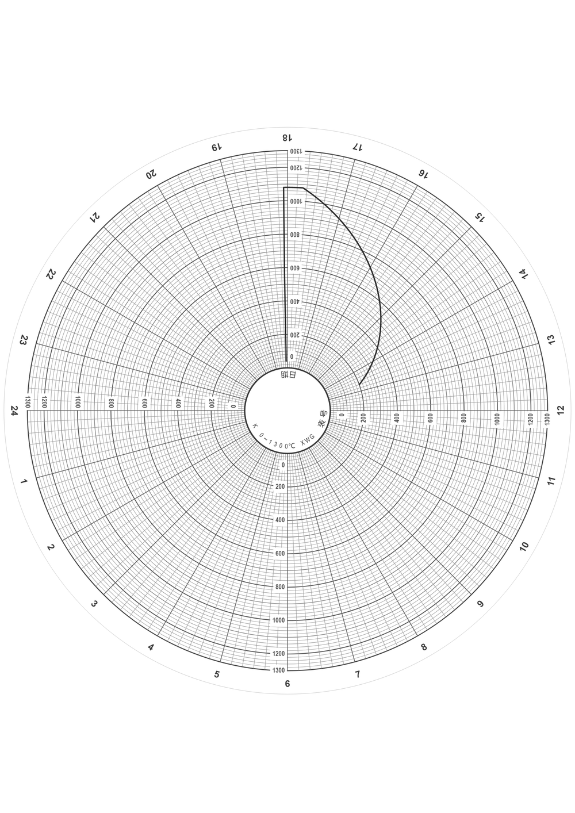

# 热处理记录纸生成器

按 XWG 圆盘记录纸（K 0~1300℃ / 24h）的真实印刷规范，在浏览器里录入工艺数据，直接生成可打印的 A4 记录纸 PNG。

**在线使用：** https://yeqiangdadi.github.io/heat-treatment-chart-generator/

## 怎么用

1. 打开网页（Chrome / Edge）。
2. 左侧「工艺参数」填写开始时刻、装炉温度、升温速率、保温温度、保温时间、冷却方式与终点温度，点「按工艺生成曲线」。
3. 需要完全按实测数据时，直接在「曲线数据」表里逐行填 时刻 / 温度，曲线会按圆盘时间轴（24h，逆时针）自动落点。
4. 「输出精度」选 300 dpi（常规打印）或 600 dpi（存档）。
5. 点「导出 PNG」，按 A4 实际尺寸打印；勾选「只导出空白记录纸」则只出底图。

## 记录纸规范

- 24 小时一周，每小时一根主刻度，每 10 分钟一根细刻度。
- 温度 0~1300℃，每 20℃ 一环；100℃ 中环、200℃ 重环。
- 温度数字与小时数字按纸张原样切向排布，标注处留白断环。
- 圆心孔位与内圈文字（K 0~1300℃ XWG、日期、表号）按扫描件比例还原。

## 本地使用

`index.html` 为单文件、无依赖、可离线：直接双击用浏览器打开即可，数据不会上传到任何服务器。

## 输出

- A4 竖版 210×297 mm，圆盘直径可调（默认 190 mm）。
- 导出 PNG 自带 300/600 dpi 元数据，插入 Word 或直接打印均按实际尺寸。